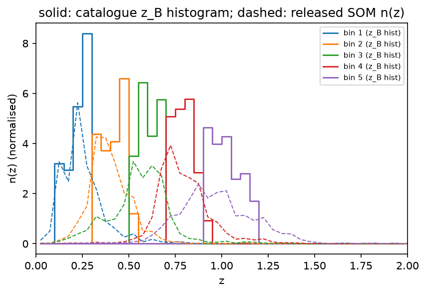
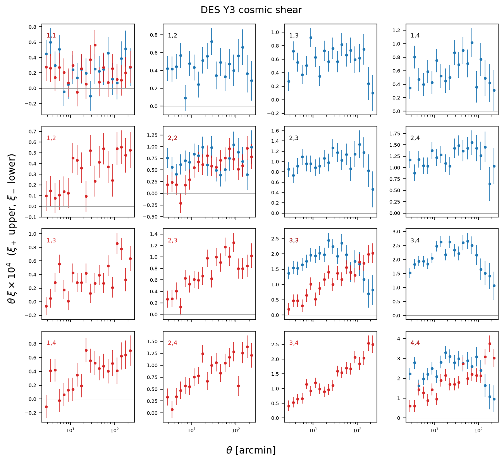
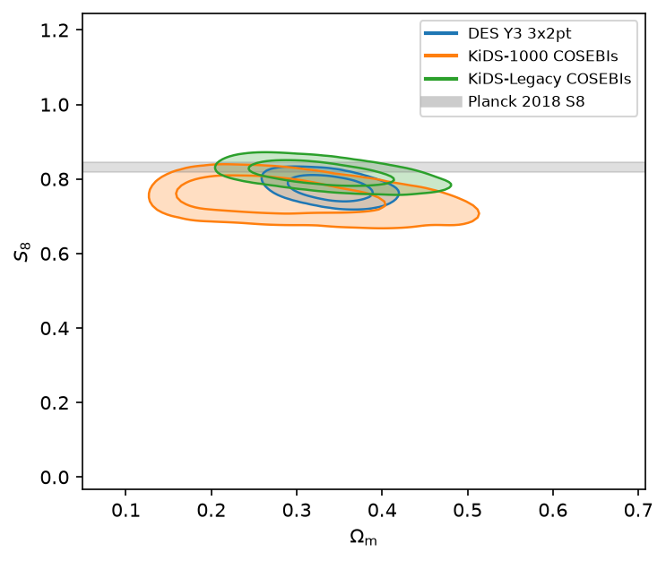

# weak-lensing-mcp-server

MCP server for public weak-lensing data: DES Y3, DES Y6, KiDS-1000, KiDS-Legacy and HSC Y3.
It reads subsets of the KiDS-1000 shear catalogue, serves the published data vectors, n(z) and covariances, and predicts ξ±(θ) with CAMB.
An agent can measure its own ξ± and B modes from galaxies, check a data vector, compute S/N, and compare S8 with published chains.

Part of the cosmo data MCP server family (sn · galaxy-surveys · cmb-data · weak-lensing · clusters). Default port: 8013.

## At a glance

| | |
|---|---|
| Surveys | KiDS-1000 (shear catalogue + data vectors), KiDS-Legacy, DES Y3, DES Y6 (published chains only), HSC Y3 |
| Tools | 24 (4 catalog, 7 summary statistic, 5 published result, 4 meta, 4 dispatch) |
| Skills | 6 (`skills/`) |
| Bundled data | 0.6 MB (KiDS-1000 tile→row index, `data/kids1000_gold_tile_runs.npz`) |
| Network | First use of every data vector, n(z) and chain; `fetch_shear_catalog` for each new KiDS-1000 tile; `compare_measured_with_published_xi`, `predict_shear_correlation` with `compare_dataset` or a served n(z) not yet cached |

## Data

| Dataset | Kind | Content | Shape and type | Source | Access |
|---|---|---|---|---|---|
| `kids_1000` gold shear catalogue | Catalog | Galaxies: ra, dec, raw lensfit e1, e2, weight, z_B (+ min/max), mag_r, SNR, PSF e1/e2, tomographic bin, tile | table, 21262011 rows over 1006 tiles (1006 deg²); slim output 14 cols | Giblin+21, KiDS DR4 server | Query (HTTP Range reads of a 17.7 GB FITS, ~17 MB per tile), cached per tile |
| `kids_1000` tile index | Catalog | Row ranges of each tile in the remote FITS | table, 96741 runs × 3 cols over 988 tiles | Built by `scripts/build_kids1000_tile_index.py` | Bundled (0.6 MB) |
| `kids_1000` data vectors | Summary statistic | ξ±, COSEBIs E_n, band powers, SOM n(z), covariance | ξ±: vector (270) + matrix (270×270); COSEBIs: vector (300) + matrix (300×300); band powers: vector (200) + matrix (200×200); n(z): 5 bins × 119 z | Asgari+21, Hildebrandt+21, KiDS server | Download (17 MB tarball), cached |
| `kids_legacy` data vectors | Summary statistic | ξ±, COSEBIs E/B, band powers E/B, n(z), covariance | ξ±: vector (378) + matrix (378×378); COSEBIs E+B: vector (840) + matrix (840×840); band powers E+B: vector (336) + matrix (336×336); n(z): 6 bins × 119 z | Wright+25, KiDS server | Download (131 MB tarball), cached |
| `des_y3` data vectors | Summary statistic | ξ±, γ_t, w(θ), source + lens n(z), covariance (MagLim; redMaGiC alternative) | MagLim: vector (1000: 200 ξ+, 200 ξ−, 480 γ_t, 120 w) + matrix (1000×1000); redMaGiC: vector (900) + matrix (900×900); source n(z): 4 bins × 300 z | Abbott+22, DES DR server | Download (28 MB / 27 MB FITS), cached |
| `hsc_y3` data vectors | Summary statistic | Real-space ξ± (Li+23), Fourier C_ℓ^EE (Dalal+23), n(z), covariance | real: vector (230: 130 ξ+, 100 ξ−) + matrix (230×230); Fourier: vector (170) + matrix (170×170); n(z): 4 bins × 161 z | Li+23, Dalal+23, CosmoSIS standard library (GitHub) | Download (0.45 MB FITS, 22 MB SACC), cached |
| `des_y6` data vectors | Summary statistic | ξ±, γ_t, w(θ), n(z), covariance | not public yet (placeholder; `fetch_wl_datavector` returns a notice) | DES Collaboration 2026 | none |
| `des_y6` chains | Published result | 13 chains: 1x2pt, 2x2pt, 3x2pt ΛCDM/wCDM, CMB alone, 3x2pt + CMB / BAO / SN / clusters / BBN | chain, weighted (Nautilus `log_weight` or csislike `weights`); fiducial 3x2pt ΛCDM: 275520 samples × 69 cols | DES Collaboration 2026, DES DR server (NCSA) | Download (2.5–388 MB each; 4.5 GB `3x2pt_nonlin_wcdm` only with `allow_large=True`), cached |
| `des_y3` chains | Published result | 7 chains: 1x2pt, 2x2pt, 3x2pt ΛCDM/wCDM, redMaGiC, Planck, Planck + DES | chain, weighted; 3x2pt ΛCDM: 22619 samples × 38 cols | Abbott+22, DES DR server | Download (5–50 MB each), cached |
| `kids_1000` chains | Published result | MultiNest chains for COSEBIs, band powers, ξ± | chain, weighted; COSEBIs: 16450 samples × 33 cols | Asgari+21 | Download (in the 17 MB tarball) |
| `kids_legacy` chains | Published result | Nautilus chains for COSEBIs, band powers, ξ±, COSEBIs + external | chain, weighted; COSEBIs: 18720 samples × 44 cols | Wright+25 | Download (in the 131 MB tarball) |
| `hsc_y3` chains | Published result | Real-space and Fourier ΛCDM chains | chain, weighted (see registry) | Li+23, Dalal+23, HSC-SSP portal | user file (needs HSC-SSP account) |
| Published S8 table | Published result | S8 ± σ of DES Y6/Y3, KiDS-1000, KiDS-Legacy, HSC Y3; Planck 2018 S8 = 0.832 ± 0.013 | table, 7 rows (`PUBLISHED_S8`) | Papers listed under Citation | Bundled (registry) |

### Where the data comes from
- Bundled: only the 0.6 MB KiDS-1000 tile index and the published S8 table. Everything else needs the network once.
- Download: data-vector files, release tarballs and chains are fetched once over HTTPS and cached in `~/.cache/cosmo-mcp/weak-lensing-mcp-server/` (override with `$COSMO_MCP_DATA`). URLs were verified on 2026-11-04 (DES Y6 chains on 2026-11-12).
- KiDS-1000 shear catalogue: the 17.7 GB FITS is never downloaded whole. `fetch_shear_catalog` reads whole tiles with HTTP Range requests, using the bundled tile→row index. Each tile costs ~17 MB of reads and is cached as a slim file in `kids_1000/shearcat_tiles/`.
- DES Y6: the 13 published chains come from the public NCSA server (`desdr-server.ncsa.illinois.edu/despublic/y6a2_files/y6_key/chains_release/`). The Y6 2pt data vectors are not public yet. Set `DES_Y6_DATAVECTORS_PUBLIC` and `DES_Y6_DV_URL` in `tools/registry.py` when they are released.
- Not fetched: DES Y3 Metacal shapes (312 GB HDF5, no subset service), KiDS-Legacy shapes (not linked publicly) and HSC Y3 shapes (HSC-SSP account). The tools raise an error with the reason.
- HSC Y3 chains need HSC-SSP credentials. Save them as `~/.cache/cosmo-mcp/weak-lensing-mcp-server/hsc_y3/<chain>.txt` and the tools pick them up.
- The KiDS server's TLS chain fails with some default CA stores. Downloads use a certifi-backed opener (`tools/datavectors/io.py`).

## Tools

### Catalog tools

| Tool | What it does | Data used | Output | Weight |
|---|---|---|---|---|
| `fetch_shear_catalog` | Reads a KiDS-1000 subset by tile, N/S patch or RA/Dec box, then cuts to tomographic bins and a row limit. Other surveys raise an error with the reason. | KiDS-1000 gold catalogue (HTTP Range reads, tile index Bundled) | Slim FITS (14 cols), counts per bin | heavy |
| `plot_shear_catalog` | Plots e1/e2, weight and z_B histograms and the sky footprint. Reports c-terms, σ_e, n_eff and counts per bin. | FITS from `fetch_shear_catalog` | PNG; σ_e, n_eff, c1, c2 in the result | light |
| `measure_shear_correlation` | Measures ξ±(θ) per bin pair with treecorr, weights, c-term removal and m-bias correction. Optional jackknife errors. With `compute_bmodes=True` it adds aperture-mass ⟨M_ap²⟩, ⟨M_ײ⟩ and a χ²(⟨M_ײ⟩ = 0) B-mode null test. | FITS from `fetch_shear_catalog` | ξ+ and ξ− CSVs (`fetch_wl_datavector` layout), settings JSON, `*_mapsq_bmodes.csv` | heavy |
| `measure_nz_from_catalog` | Histograms the weighted z_B per tomographic bin and overlays the released SOM n(z). | FITS from `fetch_shear_catalog`; KiDS-1000 n(z) (Download) | n(z) CSV, PNG, mean z per bin | light |

### Summary statistic tools

| Tool | What it does | Data used | Output | Weight |
|---|---|---|---|---|
| `compare_measured_with_published_xi` | Overlays your measured ξ± on the released KiDS-1000 ξ±. Gives χ² per pair, a mean ratio over 5–60′ and one amplitude A. | CSV from `measure_shear_correlation`; KiDS-1000 ξ± (Download) | PNG, CSV of χ² and ratios | light |
| `fetch_wl_datavector` | Writes one published 2pt statistic as a tidy CSV and its covariance block. No scale cuts. `des_y6` returns a not-yet-public notice. | DES Y3, KiDS-1000, KiDS-Legacy, HSC Y3 (Download) | CSV (bin1, bin2, angbin, x, value, error), covariance `.npy` | light |
| `plot_shear_correlation` | Draws the triangle of bin pairs: ξ+ upper, ξ− lower. Other statistics draw the upper triangle only. | CSVs from `fetch_wl_datavector` or `measure_shear_correlation` | PNG | light |
| `plot_redshift_distributions` | Plots unit-normalised n(z) per bin, one panel per dataset, and reports mean z per bin. | Served n(z) (Download) | PNG, CSV | light |
| `plot_covariance` | Plots the correlation matrix and reports positive definiteness and condition number. | `.npy` from `fetch_wl_datavector` | PNG; PD flag, condition number in the result | light |
| `compute_signal_to_noise` | Computes S/N = √(dᵀC⁻¹d) with the full covariance, combining statistics with their cross-covariance. No scale cuts. | Published data vectors (Download) | CSV | light |
| `predict_shear_correlation` | Predicts GG-only ξ±(θ) per bin pair: CAMB halofit P(k), own Limber C_ℓ and J0/J4 Hankel transform. Optional baryon P(k) ratio CSV multiplies P(k). Optional amplitude fit to served data. Needs the `[theory]` extra. | Served n(z) (kids_1000, kids_legacy, des_y3, hsc_y3; Download) or user n(z) file; optional user baryon CSV | `theory_xipm.csv` (+ DMO columns and ratios with baryons), PNG, A | light |

### Published result tools

These tools are for comparison only. Their outputs are never used as data or as a prior.

| Tool | What it does | Data used | Output | Weight |
|---|---|---|---|---|
| `fetch_wl_chain` | Writes a slim chain CSV (weight, Ωm, σ8, S8, h0, w). Derives S8 = σ8√(Ωm/0.3) if missing. | DES Y3 / Y6, KiDS-1000, KiDS-Legacy chains (Download); HSC Y3 (user file) | CSV | light |
| `analyze_wl_chain` | Computes marginals of S8, Ωm, σ8 (h, w): mean ± std, median with 16/84%, 95% interval, mode with 68% HPD. | Same chains as `fetch_wl_chain` | Marginals JSON | heavy |
| `plot_s8_om_contours` | Overlays 68/95% Ωm–S8 (or σ8) contours from a weighted, smoothed 2D histogram, with the Planck S8 band. | Chain CSVs from `fetch_wl_chain` / `fetch_des_y6_chain` | PNG | light |
| `compare_s8_with_published` | Draws an S8 whisker plot against Planck 2018 and gives the 1D Gaussian tension in σ. | Published S8 table (Bundled); optional JSONs from `analyze_wl_chain` | PNG, CSV | light |
| `fetch_des_y6_chain` | Downloads one of 13 DES Y6 chains, reads columns from the CosmoSIS header and reports weighted mean, std and 16/50/84% of Ωm, σ8, S8 (w0, wa). The 4.5 GB nonlinear-bias wCDM chain needs `allow_large=True`. | DES Y6 chains (Download, NCSA) | Summary JSON, slim chain CSV, PNG | heavy |

### Meta and dispatch tools

| Tool | What it does | Data used | Output | Weight |
|---|---|---|---|---|
| `list_wl_datasets` | Lists datasets by kind, with access and the tools that read them. | Registry | JSON | light |
| `describe_wl_dataset` | Describes one dataset: products, units, conventions, URLs, citation. | Registry | JSON | light |
| `list_wl_skills` | Lists the skills (multi-tool recipes). | `skills/` | JSON | light |
| `load_wl_skill` | Returns the full instructions of one skill. | `skills/` | Text | light |
| `auth_status` | Reports whether this server is signed in to ALCF/NERSC for HPC dispatch. | none | JSON | light |
| `get_dispatch` | Reports where heavy tools run now (local or an HPC facility). | none | JSON | light |
| `set_dispatch` | Sets where heavy tools run: local, polaris (ALCF) or perlmutter (NERSC). | none | JSON | light |
| `export_dispatch_pack` | Exports this server's compute kernels so a client can run them on HPC. | `tools/` | Files + manifest | light |

## Example figures

| | |
|---|---|
|  |  |
| KiDS-1000 catalogue subset QA (`plot_shear_catalog`) | Measured vs released KiDS-1000 ξ+ (`compare_measured_with_published_xi`) |
|  |  |
| Catalogue z_B histogram vs SOM n(z) (`measure_nz_from_catalog`) | DES Y3 ξ± triangle of bin pairs (`plot_shear_correlation`) |
|  |  |
| S8 of each survey vs Planck 2018 (`compare_s8_with_published`) | Multi-survey Ωm–S8 contours (`plot_s8_om_contours`) |

## Validation

Catalogue subset: KiDS-North RA 170–190, Dec −2…+2, 79 tiles, 1714314 galaxies (~64 deg² unmasked), 790 MB of Range reads, ~6 min.

| Check | This server | Reference |
|---|---|---|
| σ_e per component (catalogue subset) | 0.265 | ~0.27 (Giblin+21) |
| n_eff (occupied area) | 5.1 arcmin⁻² | 6.2 arcmin⁻² (Giblin+21, unmasked area) |
| Mean z_B per bin (catalogue) | 0.22 / 0.41 / 0.61 / 0.80 / 1.02 | SOM n(z) means 0.26 / 0.40 / 0.56 / 0.79 / 0.98 |
| ξ+ (bins 4–5) at 13.5′ | 1.2e-5 ± 0.8e-5 (jackknife, 40 patches) | Release: 1.8e-5 ± 0.2e-5 at 12.3′ |
| Amplitude A = measured / released ξ+ (θ > 2′, release cov × 777.4/63.9) | 0.86 ± 0.18, χ² = 82.2/105 | 1 |
| Same for ξ− | 0.86 ± 0.19, χ² = 114.1/105 | 1 |
| treecorr time, 15 pairs × 9 bins, 40 jackknife patches | 243 s (4-core laptop) | – |
| B-mode null test (6 tiles around RA 170.5, Dec 0.5, bins 3–5, ≤ 60k galaxies per bin) | χ²(⟨M_ײ⟩ = 0) = 23.2/32, PTE 0.87 | PTE > 0.05 |
| `predict_shear_correlation` vs served ξ+, KiDS-1000 n(z), Ωm 0.27, S8 0.76 (0.5–75′, diagonal errors) | A = 0.892 ± 0.025 | < 1 expected (no IA in model) |
| Same, DES Y3, Ωm 0.29, S8 0.78 | A = 0.945 ± 0.013 | < 1 expected |
| Same, DES Y3, Planck Ωm 0.315, S8 0.832 | A = 0.809 ± 0.011 | – |
| DES Y6 3x2pt ΛCDM (fiducial) chain | S8 = 0.7888 ± 0.0112, Ωm = 0.325 ± 0.023, σ8 = 0.759 ± 0.033 | DES 2026: S8 = 0.789 ± 0.012, Ωm = 0.333 +0.023/−0.028 |
| DES Y6 cosmic shear (1x2pt) chain | S8 = 0.783 ± 0.017, Ωm = 0.321 ± 0.041 | – |
| DES Y6 3x2pt + CMB chain | S8 = 0.811 ± 0.008, Ωm = 0.312 ± 0.008 | – |
| DES Y3 3x2pt ΛCDM chain | S8 = 0.776 ± 0.018 | 0.776 ± 0.017 (`tests/test_wl.py`) |
| KiDS-1000 COSEBIs chain | S8 = 0.751 ± 0.022 (mode 0.760) | 0.759 +0.024/−0.021 (MAP, PJ-HPD) |
| KiDS-Legacy COSEBIs chain | S8 = 0.814 ± 0.019 | 0.813 ± 0.018 (mean) |
| HSC Y3 real space | Credentialed chain; published value used | 0.769 +0.031/−0.034 |

## Skills

| Skill | Use it to |
|---|---|
| `wl-tour` | Run one call per tool family: catalogue subset, own ξ± and n(z), data vectors and S/N, published S8. |
| `measure-kids1000-xi-from-catalogue` | Measure KiDS-1000 ξ± in 5 bins from a ~75 deg² catalogue subset and validate against the release. |
| `reproduce-des-y3-shear-figure` | Reproduce the DES Y3 ξ± figure, plus the KiDS and HSC equivalents. |
| `wl-datavector-inspection` | Check statistics, n(z), covariance health and S/N of a data vector before use. |
| `s8-tension-across-surveys` | Compare S8 of DES Y6/Y3, KiDS and HSC with Planck 2018 from published chains (comparison only). |
| `hpc-dispatch-handoff` | Run heavy kernels on ALCF Polaris or NERSC Perlmutter. |

## Install and run

```bash
python -m venv .venv && .venv/bin/pip install -e ".[dev,theory]"
.venv/bin/python -m mcp_server                 # stdio (or ./run_server.sh)
.venv/bin/python -m mcp_server --transport streamable-http --port 8013
MPLBACKEND=Agg .venv/bin/python -m pytest -q    # tests (network tests: -m network)
```

- `theory` installs `camb` for `predict_shear_correlation`. pyccl is not used: its macOS wheels need libomp.
- `treecorr>=5.0.1` and `sacc` are core dependencies. treecorr 5.0.1 is the last release with a macOS x86_64 wheel.
- `getdist` is optional. Contours use a weighted, smoothed histogram.

## Limitations

- Only the KiDS-1000 shear catalogue is fetched. DES Y3 (312 GB HDF5), KiDS-Legacy (not linked) and HSC Y3 (account) shapes are not.
- DES Y6 2pt data vectors, n(z) and covariance are not public yet. `fetch_wl_datavector(dataset="des_y6")` returns a notice.
- Catalogue e1, e2 are raw lensfit values. `measure_shear_correlation` applies the Asgari+21 m-bias per bin; other uses must apply it.
- Errors from `measure_shear_correlation` are shape noise or jackknife only, without cosmic variance. A few-deg² subset gives a noisy ξ±.
- `measure_nz_from_catalog` is a naive z_B histogram. It lacks the outlier tails of the SOM n(z) and is not analysis grade.
- `predict_shear_correlation` is GG only: no intrinsic alignments, shear bias or photo-z shifts. It uses Limber in flat cosmology.
- Data vectors are served without scale cuts. S/N values are raw measurement S/N.
- HSC Y3 chains need HSC-SSP credentials and a manual download.
- The 4.5 GB DES Y6 `3x2pt_nonlin_wcdm` chain is downloaded only with `allow_large=True`.

## Citation

- KiDS-1000 shear catalogue: Giblin et al. 2021, A&A 645, A105; Kuijken et al. 2019 (DR4).
- KiDS-1000 cosmic shear: Asgari et al. 2021, A&A 645, A104 (arXiv:2007.15633); Hildebrandt et al. 2021 (n(z)).
- KiDS-Legacy: Wright et al. 2025, A&A 703, A158 (arXiv:2503.19441); Stölzner et al. 2025.
- DES Y3: DES Collaboration (Abbott et al.) 2022, PRD 105, 023520 (arXiv:2105.13549); Amon et al. 2022; Secco et al. 2022.
- DES Y6: DES Collaboration 2026 (arXiv:2601.14559).
- HSC Y3: Li et al. 2023, PRD 108, 123518 (arXiv:2304.00702); Dalal et al. 2023, PRD 108, 123519 (arXiv:2304.00701).
- Planck 2018: Planck Collaboration 2020, A&A 641, A6.
- Tools: treecorr (Jarvis et al. 2004); CAMB (Lewis et al. 2000); halofit (Takahashi et al. 2012).
