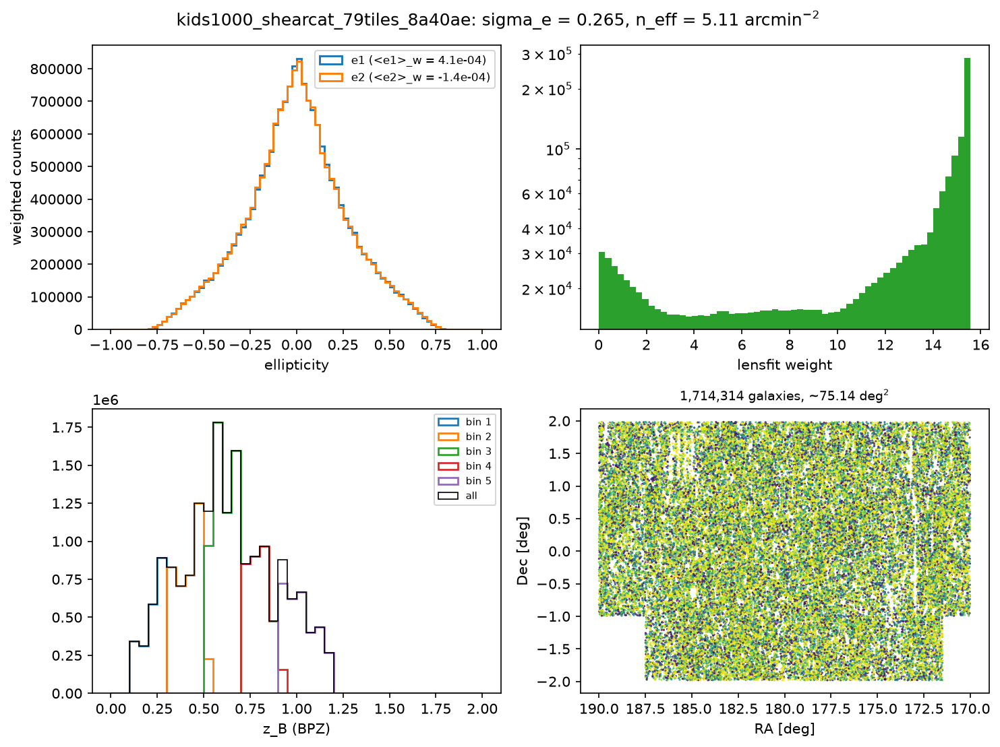
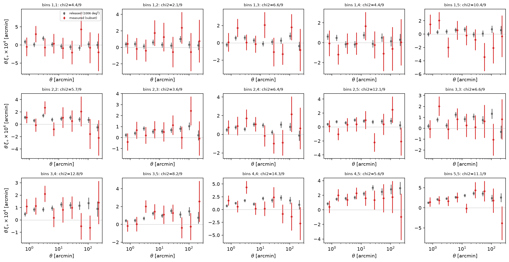
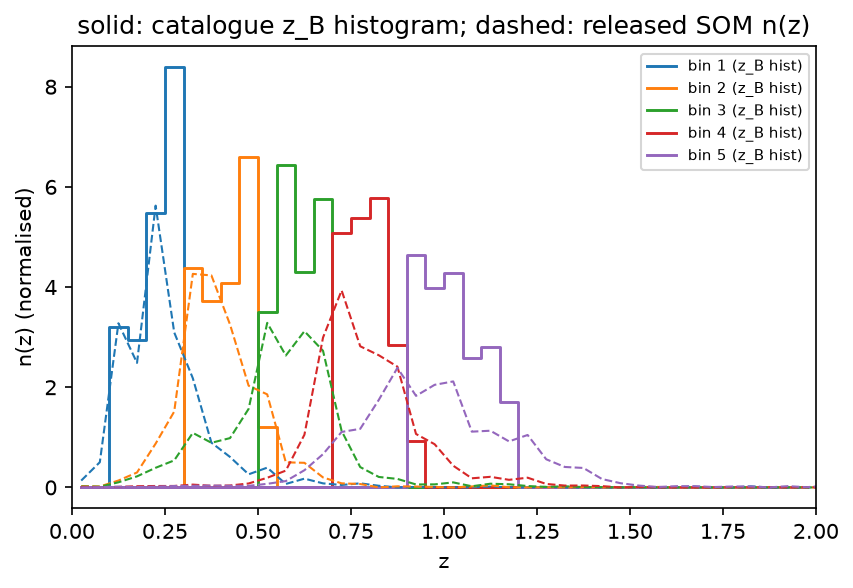
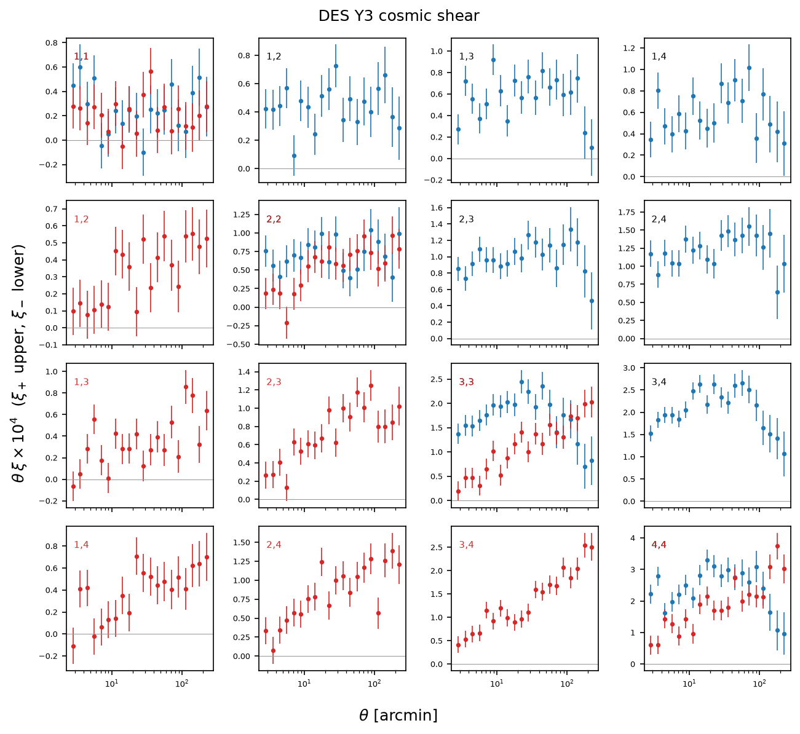
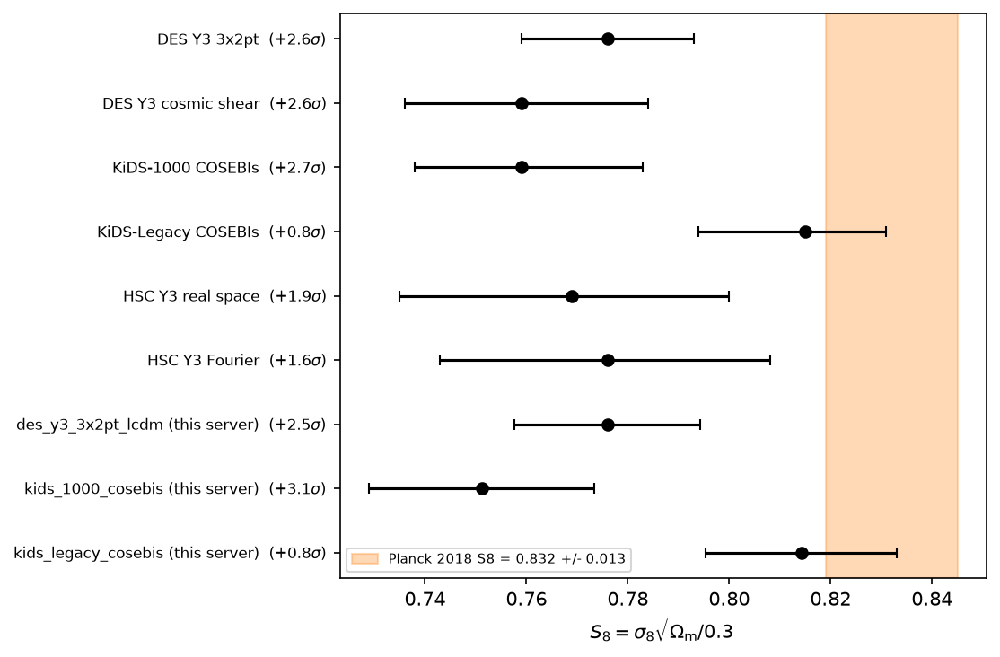
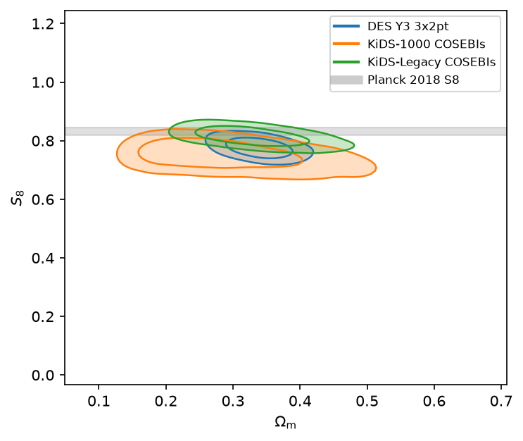

# weak-lensing-mcp-server

MCP server ("Weak Lensing Surveys MCP Server", tool prefix `wl`) for public
weak-lensing data: the KiDS-1000 gold **shear catalogue** (read as sky/tile/bin
subsets), the data vectors, n(z) and covariances of DES Y3, KiDS-1000,
KiDS-Legacy and HSC Y3 (summary statistics), and their published chains / S8
values (published results, for comparison only). DES Y6 is registered but not yet public.
It is part of the cosmo-*-mcp family, built from `cosmo-mcp-template`.

## Data products
Analyses are built on catalogs and summary statistics. Published results are for comparison only and are never fed in as data or as a prior.
| dataset | Catalogs | Summary statistics (+ cov) | Published results (comparison only) | access |
|---|---|---|---|---|
| kids_1000 | gold WL shear catalogue, 21,262,011 galaxies / 1006 deg^2 (Giblin+21): ra, dec, e1, e2, weight, z_B, mag, SNR, PSF e | xi+-, COSEBIs, band powers, SOM n(z), cov | MultiNest chains (xipm / COSEBIs / bp) | catalogue: 17.7 GB FITS read by HTTP Range as subsets (tile, N/S patch, RA-Dec box, tomo bin, row limit); release tarball 17 MB |
| des_y3 | Metacal shape catalogue public but 312 GB HDF5 with no subset service: **not fetched** | xi+-, gamma_t, w(theta), n(z), cov | ~30 chains | download (28 MB FITS) |
| kids_legacy | shear catalogue not publicly linked (2026-11-04) | xi+-, COSEBIs E/B, band powers E/B, n(z), cov | Nautilus chains | download (131 MB) |
| hsc_y3 | shape catalogue needs an HSC-SSP account (HTTP 401) | real xi+-, Fourier C_ell, n(z), cov | chains (credentialed) | download (CSL mirror) |
| des_y6 | - | - | - | unreleased |
| (all) | | | published S8 table (`PUBLISHED_S8`), Planck 2018 S8 | built in |

Catalogue notes: the KiDS-1000 catalogue rows are interleaved across tiles in short runs, so a bundled
index (`data/kids1000_gold_tile_runs.npz`, 0.6 MB, 96,741 runs over 988 tiles; rebuild with
`scripts/build_kids1000_tile_index.py`) maps each tile to its row ranges. A tile costs ~17 MB of
remote reads (all 51 columns), and the slim 13-column subset is cached per tile under
`kids_1000/shearcat_tiles/`. DES Y3 shape catalogues:
`desdr-server.ncsa.illinois.edu/despublic/y3a2_files/y3kp_cats/DESY3_metacal_v03-004.h5`
(312,037,859,376 bytes; see des.ncsa.illinois.edu/releases/y3a2/Y3key-catalogs). These are
practical only on a facility (h5py + the 27 GB index catalogue), so the server raises a clear error.

## Datasets
| key | products | access | source (verified 2026-11-04) |
|---|---|---|---|
| des_y3 | xi+-, gamma_t, w(theta), n(z) source+lens, 1000x1000 cov; ~30 chains | download (28 MB FITS, 5-50 MB chains) | desdr-server.ncsa.illinois.edu/despublic/y3a2_files/{datavectors,chains}/ |
| des_y6 | - | unreleased (y6key_products/ is empty) | desdr-server.ncsa.illinois.edu/despublic/y6a2_files/ |
| kids_1000 | **shear catalogue**; xi+-, COSEBIs, band powers, n(z), cov; MultiNest chains | catalogue: Range-read subsets of the 17.7 GB FITS (kids.strw.leidenuniv.nl/DR4/data_files/KiDS_DR4.1_ugriZYJHKs_SOM_gold_WL_cat.fits); release: 17 MB tarball | kids.strw.leidenuniv.nl/DR4/data_files/KiDS1000_cosmic_shear_data_release.tgz |
| kids_legacy | xi+-, COSEBIs E/B, band powers E/B, n(z), cov; Nautilus chains | download (131 MB tarball) | kids.strw.leidenuniv.nl/sci_data/KiDS_Legacy_cosmic_shear_data_release.tar.gz |
| hsc_y3 | real-space xi+- (Li+23), Fourier C_ell SACC (Dalal+23), n(z), cov | download (CosmoSIS standard library mirror); chains credentialed | raw.githubusercontent.com/cosmosis-developers/cosmosis-standard-library/main/likelihood/hsc_cosmic_shear/ |

Notes: the KiDS server's TLS chain fails with some Python default CA stores, so
downloads use a certifi-backed opener inside `tools/datavectors/io.py`. The HSC
portal (hsc-release.mtk.nao.ac.jp) returns HTTP 401 without HSC-SSP credentials.
HSC chains therefore raise an error with manual-download steps. Save the chain as
`~/.cache/cosmo-mcp/weak-lensing-mcp-server/hsc_y3/<chain>.txt` and the tools pick it up.
Only the 0.6 MB KiDS-1000 tile index is bundled; the cache is `~/.cache/cosmo-mcp/weak-lensing-mcp-server` (`$COSMO_MCP_DATA`).

## Tools
Shear catalogue (`tools/catalogs`):
- `fetch_shear_catalog(output_dir, tiles | patch | ra_range/dec_range, tomo_bins, max_tiles, max_rows)` (heavy) - KiDS-1000 gold catalogue subset -> slim FITS
- `plot_shear_catalog` - e1/e2, weight, z_B histograms + sky footprint; sigma_e, n_eff, c-terms
- `measure_shear_correlation` (heavy, dispatchable kernel `catalogs.kernels.shear_correlation`, treecorr) - from shear catalogue to xi+/xi- per bin pair, weights, m-correction, c-term removal; CSV in the fetch_wl_datavector layout
- `measure_nz_from_catalog` - from shear catalogue to a weighted z_B histogram per bin, overlaid on the released SOM n(z)

Summary statistics (data vectors):
- `compare_measured_with_published_xi` - your measured xi vs the released KiDS-1000 xi per bin pair (chi2, ratio)
- `fetch_wl_datavector(dataset, statistic)` - tidy CSV (bin1, bin2, angbin, x, value, error) + covariance .npy
- `plot_shear_correlation` - xi+ / xi- triangle of bin pairs (DES/KiDS paper style)
- `plot_redshift_distributions` - n(z) per tomographic bin, multi-survey
- `plot_covariance` - correlation matrix, PD check, condition number
- `compute_signal_to_noise` - sqrt(d^T C^-1 d) with cross-covariance

Published results (for comparison only):
- `fetch_wl_chain` - published chain -> slim CSV (weight, Om, sigma8, S8, h0, w)
- `analyze_wl_chain` (heavy, dispatchable kernel `chains.kernels.chain_marginals`) - marginals, mode/HPD
- `plot_s8_om_contours` - multi-survey 68/95% contours with Planck band
- `compare_s8_with_published` - S8 whisker plot vs Planck 2018 (0.832 +/- 0.013) and tension in sigma
- meta: `list_wl_datasets`, `describe_wl_dataset`, `list_wl_skills`, `load_wl_skill`; dispatch tools from the template

Skills: `wl-tour`, `measure-kids1000-xi-from-catalogue` (shear catalogue to xi+-), `s8-tension-across-surveys` (published results, for comparison only), `reproduce-des-y3-shear-figure`,
`wl-datavector-inspection`, `hpc-dispatch-handoff`.

## Sanity numbers, from shear catalogue to xi+- (this server, KiDS-1000 catalogue subsets)
Subset: KiDS-North RA 170-190, Dec -2..+2 = 79 tiles, 1,714,314 galaxies (~64 deg^2 unmasked); 790 MB of Range reads, ~6 min.
| quantity | this server | literature / release |
|---|---|---|
| sigma_e per component | 0.265 | ~0.27 (Giblin+21) |
| n_eff (occupied area) | 5.1 arcmin^-2 | 6.2 (Giblin+21, unmasked area) |
| mean z_B per bin (catalogue) | 0.22 / 0.41 / 0.61 / 0.80 / 1.02 | SOM n(z) means 0.26 / 0.40 / 0.56 / 0.79 / 0.98 |
| xi+ (4-5) at 13.5 arcmin | 1.2e-5 +/- 0.8e-5 (jackknife, 40 patches) | release 1.8e-5 +/- 0.2e-5 at 12.3 arcmin |
| amplitude A = measured / released xi+ (theta > 2', release cov x 777.4/63.9) | 0.86 +/- 0.18, chi2 = 82.2/105 | 1 |
| same for xi- | 0.86 +/- 0.19, chi2 = 114.1/105 | 1 |
| treecorr time, 15 pairs x 9 bins, 40 jackknife patches | 243 s (4-core laptop) | - |





## Sanity numbers, published results (from the public chains, for comparison only)
These S8 values are the surveys' own inference, used for comparison only.
| chain | S8 (mean +/- std) | paper |
|---|---|---|
| DES Y3 3x2pt LCDM | 0.776 +/- 0.018 | 0.776 +/- 0.017 |
| KiDS-1000 COSEBIs | 0.751 +/- 0.022 (mode 0.760, max-post 0.760) | 0.759 +0.024/-0.021 (MAP, PJ-HPD) |
| KiDS-Legacy COSEBIs | 0.814 +/- 0.019 | 0.813 +/- 0.018 (mean) |
| HSC Y3 real space | credentialed chain - published value used | 0.769 +0.031/-0.034 |





## Install / run
```bash
uv venv --python 3.12 .venv && uv pip install --python .venv/bin/python -e ".[dev]"
.venv/bin/python -m mcp_server --transport stdio            # or ./run_server.sh
.venv/bin/python -m mcp_server --transport streamable-http   # port 8013
```
`treecorr>=5.0.1` is a core dependency (5.0.1 is the last release with a macOS x86_64 wheel; newer ones build from source).
Optional extra: `getdist` (not required; contours use a weighted smoothed histogram). `sacc` is a core dependency (HSC Fourier C_ell + n(z)).
Tests: `MPLBACKEND=Agg .venv/bin/python -m pytest -q` (`-m "not network"` offline).
